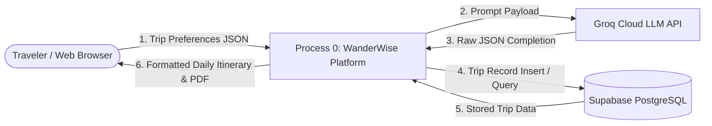
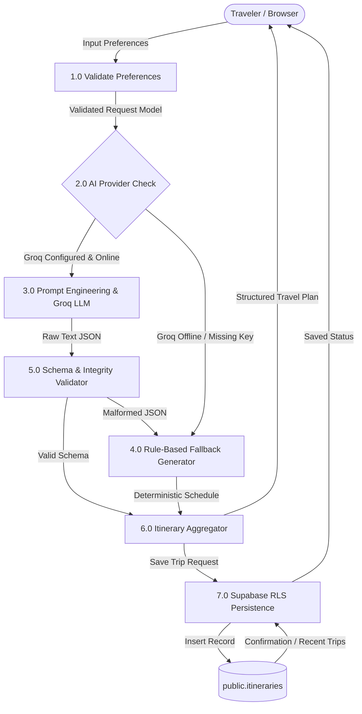

# WanderWise — Personalized Travel Itinerary Planner
## Phase 2: Requirement Analysis Documentation

---

### Project Header & Administrative Information

| Parameter | Details |
| :--- | :--- |
| **Project Title** | WanderWise — Generative AI-Based Personalized Travel Itinerary Planner |
| **Project Category** | Generative Artificial Intelligence (Generative AI) |
| **Document Phase** | Phase 2: Requirement Analysis |
| **Date** | 31 January 2026 |
| **Team ID** | [TO BE PROVIDED] |
| **Repository URL** | [https://github.com/Aanchal1121/personalized-travel-itinerary-planner](https://github.com/Aanchal1121/personalized-travel-itinerary-planner) |
| **Maximum Marks** | 12 Marks (Customer Journey: 2, Solution Requirements: 4, DFD & User Stories: 4, Tech Stack: 2) |

---

## 1. Customer Journey Map (Maximum Marks: 2 Marks)

The Customer Journey Map tracks the traveler's experience stage-by-stage across touchpoints, mental models, emotional valences, backend operational ownership, and opportunities for continuous enhancement.

| Phase of Journey | Stage 1: Discovery & Input | Stage 2: AI Processing & Inference | Stage 3: Itinerary Review & Inspection | Stage 4: Navigation & Exploration | Stage 5: Export & Cloud Persistence |
| :--- | :--- | :--- | :--- | :--- | :--- |
| **Actions** *(What does the customer do?)* | • Accesses WanderWise web application. • Inputs destination (e.g., "Kyoto, Japan"). • Selects duration (1–14 days), budget, style, pace, travelers, dietary restrictions. | • Clicks "Generate My Itinerary". • Observes animated loading ticker. • Waits 1.5–3.0 seconds for response. | • Inspects synthesized daily cards. • Examines morning, afternoon, evening activities. • Checks geographic route order and transit times. | • Switches between day tabs (`View All`, `Day 1`, `Day 2`...). • Reads budget strategy and local travel tips. • Reviews alternative activity suggestions. | • Clicks "Copy Itinerary" to clipboard. • Clicks "Print / PDF" to create offline document. • Clicks "Save Trip" to store itinerary in Supabase. |
| **Touchpoint** *(Service component interacted with)* | • React 18 multi-step preference wizard (`App.jsx`). • Input fields with real-time validation badges. | • Frontend animated step spinner (`.spinner`). • FastAPI async endpoint `POST /generate-itinerary`. | • Structured Itinerary Card UI (`.itinerary-card`). • Route sequence bar (`.route-flow`). | • Responsive Day Switcher tab bar (`.day-tab`). • Personalization note cards (`.vibe-badge`). | • Browser Clipboard API (`navigator.clipboard`). • Native Print Dialog (`window.print()`). • Supabase REST API `POST /trips`. |
| **Customer Thought** *(What is the customer thinking?)* | *"Will this tool actually listen to my vegetarian diet and moderate pace?"* | *"I hope this doesn't time out or give me generic tourist traps."* | *"Wow, Kiyomizu-dera and Gion are placed in sequence, avoiding backtracking!"* | *"Let me see what Day 3 looks like and whether the daily budget makes sense."* | *"I want this PDF on my phone so I can access my plan even if I lose roaming data."* |
| **Customer Feeling** *(Emotional state)* | Anticipation, mild skepticism, curiosity. | Engaged, curious, brief waiting suspense. | Impressed, relieved, confident in the plan. | Delighted, organized, in control of the trip. | Satisfied, accomplished, travel-ready. |
| **Process Ownership** *(Lead component / team)* | Frontend Engineer / UX Designer (`travelPrompt.js`). | Generative AI Engineer / Backend Lead (`groq_provider.py` & `main.py`). | Frontend Lead & AI Architect (`App.jsx` & `prompts.py`). | Frontend UI Engineer (`App.css` design system). | Full-Stack & Database Lead (`supabase.js` & `main.py`). |
| **Opportunities** *(How to improve this stage)* | Add intelligent destination autocomplete suggestions and quick preset trip templates. | Implement streaming token responses (SSE) for perceived instantaneous completion. | Add an interactive Leaflet/Mapbox visual map with pins for each activity stop. | Enable in-place editing so users can drag-and-drop or reorder individual daily stops. | Integrate automated calendar synchronization (.ics export for Google Calendar / Apple Calendar). |

---

## 2. Solution Requirements (Maximum Marks: 4 Marks)

### 2.1 Functional Requirements (Epics & Stories)

| FR No. | Functional Requirement (Epic) | Sub Requirement (Story / Sub-Task) | Priority | Implementation Status |
| :---: | :--- | :--- | :---: | :---: |
| **FR-1** | **Preference Ingestion (Epic 3)** | Collect destination, days (1–14), budget ($), travel style, specific interests, pace, traveler count (1–20), and dietary requirements. | High | **Implemented & Verified** |
| **FR-2** | **Client & Server Input Validation (Epic 3)** | Validate input constraints on both client-side (`travelPrompt.js`) and server-side (`Pydantic` `ItineraryRequest`) before invoking LLM. | High | **Implemented & Verified** |
| **FR-3** | **Generative AI Itinerary Synthesis (Epic 4.1)** | Formulate structured system prompts enforcing strict JSON schema compliance via Groq Cloud API (`openai/gpt-oss-20b` or `llama-3.3-70b-versatile`). | High | **Implemented & Verified** |
| **FR-4** | **Route Sequencing & Transit Estimation (Epic 4.2)** | Order morning, afternoon, and evening activities in logical geographic sequence with realistic visit durations and transit buffers between stops. | High | **Implemented & Verified** |
| **FR-5** | **Deterministic Local Fallback Engine (Epic 4.1)** | Automatically synthesize rule-based, schema-identical fallback itineraries if Groq API is offline, invalid JSON is returned, or API key is unset. | High | **Implemented & Verified** |
| **FR-6** | **Vibe & Budget Personalization (Epic 4.3)** | Provide human-readable rationale explaining why activities match traveler style, pace, dietary needs, and sensible daily budget allocations. | Medium | **Implemented & Verified** |
| **FR-7** | **Interactive Presentation & Day Switcher (Epic 5)** | Render responsive cards with dynamic day tabs (`View All`, `Day 1`...), route visualizers, badge chips, and animated loading indicators. | High | **Implemented & Verified** |
| **FR-8** | **Clipboard Copy & Native PDF Export (Epic 5)** | Enable one-click formatted plain-text copying to system clipboard and native CSS print styling for clean PDF export without UI clutter. | Medium | **Implemented & Verified** |
| **FR-9** | **Cloud Persistence & Trip Retrieval (Epic 2)** | Save trip itineraries to Supabase PostgreSQL table `itineraries` via server-side service role and query recent trips via `GET /trips`. | Medium | **Implemented & Verified** |

### 2.2 Non-Functional Requirements (NFRs)

| NFR No. | Requirement Category | Metric / Specification | Architectural Implementation |
| :---: | :--- | :--- | :--- |
| **NFR-1** | **Usability** | Form completion in < 60 seconds; responsive layout on mobile (320px) to 4K desktops (3840px); clear inline validation errors. | Designed with custom Vanilla CSS, clean typography (*Plus Jakarta Sans*), accessible contrast ratios (> 4.5:1), and multi-step stepper. |
| **NFR-2** | **Security** | Zero client-side leakage of sensitive credentials; strict input sanitization; SQL injection prevention; least-privilege database policies. | `SUPABASE_SERVICE_ROLE_KEY` and `GROQ_API_KEY` reside strictly in server `.env`; Pydantic v2 type coercion; Supabase Row Level Security (RLS) enabled. |
| **NFR-3** | **Reliability & Resilience** | 99.9% uptime for itinerary generation; zero crash tolerance during external AI service outages. | Dual-engine architecture: Groq API wrapped in try-catch blocks with seamless, transparent automatic fallback to `fallback_generator.py`. |
| **NFR-4** | **Performance & Latency** | AI itinerary generation completed in < 3.0 seconds; fallback generation completed in < 15 milliseconds; frontend initial render in < 800ms. | Groq LPU hardware acceleration; lightweight Vite 5 ESM bundle (< 180 kB uncompressed); asynchronous FastAPI endpoints (`async def`). |
| **NFR-5** | **Availability** | Seamless multi-tier deployment; stateless API nodes capable of horizontal scaling. | Backend configured for Render auto-healing web services (`render.yaml`); Frontend configured for global CDN edge nodes on Vercel/Netlify. |
| **NFR-6** | **Maintainability & Extensibility**| Modular codebase following separation of concerns; clean abstraction layer for interchangeable LLM providers. | Abstract base class `BaseLLMProvider` in `backend/llm/base.py` allows swapping Groq with OpenAI, Anthropic, or local Ollama with zero app changes. |

---

## 3. Data Flow Diagrams & System Decomposition (Maximum Marks: 4 Marks)

### 3.1 DFD Standard Notation Reference
* **External Entity (Square / Double Rectangle)**: Sources or destinations of data outside the system boundary (e.g., Traveler / Web Browser, Groq AI Cloud).
* **Process (Rounded Rectangle / Circle)**: Activities that transform data (e.g., Validate Request, Synthesize Itinerary).
* **Data Store (Open Rectangle / Double Lines)**: Repositories where data is held persistently (e.g., Supabase PostgreSQL `itineraries` table).
* **Data Flow (Labeled Arrow)**: Directed paths showing data moving between entities, processes, and data stores.

### 3.2 DFD Level 0 (Context Diagram)
The Level 0 Context Diagram depicts the entire WanderWise system as a single central process interacting with external entities.

### 3.3 DFD Level 1 (System Process Decomposition)
The Level 1 Diagram decomposes the system into core operational sub-processes:

---

## 4. User Stories & Acceptance Criteria

| User Type | Functional Requirement (Epic) | User Story ID | User Story / Task Description | Acceptance Criteria | Priority | Release Target |
| :--- | :--- | :---: | :--- | :--- | :---: | :---: |
| **Independent Traveler** | Epic 3: Preference Engine | **USN-01** | As a traveler, I want to input my destination, duration (1–14 days), budget, and travel style so the planner understands my trip parameters. | • Form accepts valid inputs. • Rejects days < 1 or > 14 with helpful inline message. • Rejects budget $\le$ 0. | High | Sprint-1 |
| **Niche Traveler** | Epic 3: Preference Engine | **USN-02** | As a traveler with dietary restrictions and specific hobbies, I want to specify my diet (e.g. vegetarian, vegan) and pace (relaxed, balanced, fast-paced). | • Options appear in multi-step wizard. • Selected tags appear in Review Step. • Included in API request payload. | High | Sprint-1 |
| **All Travelers** | Epic 4.1: AI Generation | **USN-03** | As a user, I want the system to generate a day-by-day itinerary with exact morning, afternoon, and evening activities in under 3 seconds. | • Itinerary contains exactly $N$ days. • Each day has morning, afternoon, evening blocks. • Timing and duration in minutes provided. | High | Sprint-1 |
| **All Travelers** | Epic 4.2: Route Optimization| **USN-04** | As a traveler, I want attractions ordered in a sensible geographic sequence so that I minimize transit time and avoid backtracking. | • `route_order` array lists attractions in sequence. • Route flow visualizer renders stop order. • Transit times between stops are calculated. | High | Sprint-2 |
| **Cost-Conscious User** | Epic 4.3: Personalization | **USN-05** | As a budget traveler, I want to see personalized daily budget allocations and alternative activity suggestions. | • Estimated daily budget displayed per day. • Rationale explains spending strategy. • Rain/crowd backup alternatives listed. | Medium | Sprint-2 |
| **Mobile Roamer** | Epic 4.1: Resilience | **USN-06** | As a mobile traveler, I want the application to still generate an itinerary even if the cloud AI provider is down or rate-limited. | • Local fallback engine kicks in automatically. • Itinerary schema remains 100% identical. • Badge transparently shows fallback source. | High | Sprint-2 |
| **Active Traveler** | Epic 5: Productization | **USN-07** | As a user, I want to switch between individual day tabs and view the complete itinerary at once. | • Tab bar renders: "View All", "Day 1", "Day 2"... • Clicking a tab smoothly filters the view. • Active tab highlighted with accent badge. | Medium | Sprint-2 |
| **Traveler on the Go** | Epic 5: Productization | **USN-08** | As a user, I want to copy the complete itinerary to my clipboard or print it as a clean PDF for offline access. | • "Copy Itinerary" formats clean markdown/text. • Displays "Copied!" confirmation badge. • Print button invokes styled print sheet. | High | Sprint-3 |
| **Returning Traveler** | Epic 2: Data Persistence | **USN-09** | As a user, I want to save my generated trip to the cloud so I can retrieve recent itineraries later. | • Trip saved to Supabase `itineraries` table. • Saved trip receives unique UUID. • `GET /trips` retrieves list of recent trips. | Medium | Sprint-3 |

---

## 5. Technology Stack Definition & Justification (Maximum Marks: 2 Marks)

The WanderWise technology stack was curated specifically for modern Generative AI engineering, maximum responsiveness, sub-second latency, and enterprise-grade reliability.

| S.No | Component | Description & Role | Selected Technology | Technical Justification & Purpose |
| :---: | :--- | :--- | :--- | :--- |
| **1.** | **Front-End User Interface** | Client application for multi-step preference input, real-time validation, and responsive itinerary presentation. | **React 18, Vite 5, Vanilla CSS, Plus Jakarta Sans** | • React 18 concurrent rendering for fluid DOM updates. • Vite 5 for instant HMR and lightweight bundle size. • Vanilla CSS eliminates heavy utility frameworks (Tailwind) while ensuring full control over glassmorphism, micro-animations, and responsive print media queries. |
| **2.** | **Backend API & Framework** | High-performance asynchronous REST API handling validation, orchestration, and persistence. | **Python 3.10+, FastAPI, Pydantic v2, Uvicorn** | • FastAPI provides native async/await for non-blocking I/O during LLM and database network requests. • Pydantic v2 enforces strict type validation and automatic OpenAPI Swagger documentation (`/docs`). • Uvicorn ASGI server ensures high concurrency. |
| **3.** | **Generative AI Inference** | Cloud LLM provider for contextual itinerary reasoning, geographic clustering, and JSON synthesis. | **Groq Cloud API (`groq` Python SDK)** Models: `openai/gpt-oss-20b` or `llama-3.3-70b-versatile` | • Groq Language Processing Units (LPUs) provide near-instantaneous inference (> 300 tokens/sec), completing multi-day prompts in ~2.5s. • Advanced reasoning models generate rich cultural context and topological clustering. |
| **4.** | **Fault Tolerance & Fallback** | Deterministic rule-based local generator for 100% availability during external outages. | **Local Python Engine (`fallback_generator.py`)** | • Eliminates single-point-of-failure risks. • Employs deterministic activity pools categorized by travel style and pace. • Guarantees zero downtime even when offline or uncredited. |
| **5.** | **Database & Persistence** | Managed cloud database storing structured trip records and JSONB itinerary objects. | **Supabase PostgreSQL with PostgREST** | • Managed PostgreSQL with native `JSONB` support for complex multi-day nested itinerary structures. • PostgREST enables fast REST access. • Row Level Security (RLS) ensures least-privilege security policies. |
| **6.** | **Production Deployment** | Cloud infrastructure hosting frontend static assets and backend ASGI web service. | **Render (Backend), Vercel / Netlify (Frontend)** | • Render Blueprint (`render.yaml`) provides automated environment builds and health check routing. • Vercel/Netlify provides global edge CDN caching for single-page applications. |
| **7.** | **Security & Isolation** | Cross-Origin isolation and server-side secret management. | **FastAPI CORS Middleware, `python-dotenv`** | • Strict origin whitelisting (`CORS_ORIGINS`). • Supabase Service-Role key and Groq API key kept strictly server-side, never exposed to client browsers. |

---

## 6. Phase 2 Sign-Off & Verification Checklist

| Requirement Analysis Deliverable | Status | Verification Reference |
| :--- | :---: | :--- |
| Customer Journey Map | Completed | Section 1 (5 Stages: Discovery, Processing, Review, Navigation, Export) |
| Functional Requirements (Epics & Stories) | Completed | Section 2.1 (FR-1 through FR-9 mapped to repository epics) |
| Non-Functional Requirements (NFRs) | Completed | Section 2.2 (Usability, Security, Reliability, Performance, Availability) |
| DFD Level 0 (Context Diagram) | Completed | Section 3.2 (Mermaid context diagram) |
| DFD Level 1 (Decomposition Diagram) | Completed | Section 3.3 (Mermaid process decomposition diagram) |
| User Stories & Acceptance Criteria | Completed | Section 4 (USN-01 to USN-09 with story points and priorities) |
| Technology Stack Definition & Justification | Completed | Section 5 (All 7 architectural tiers justified without Snowflake/ETL) |
