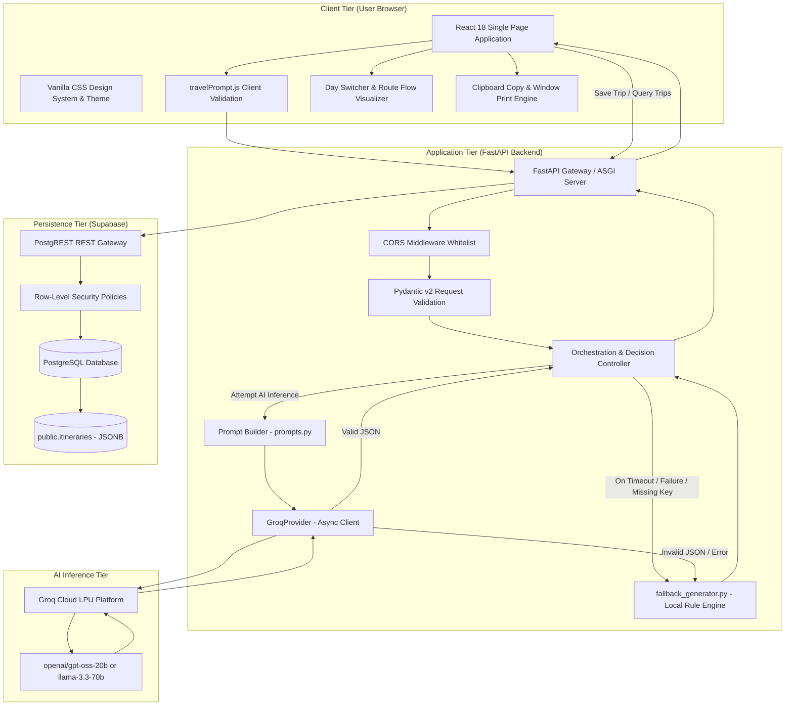
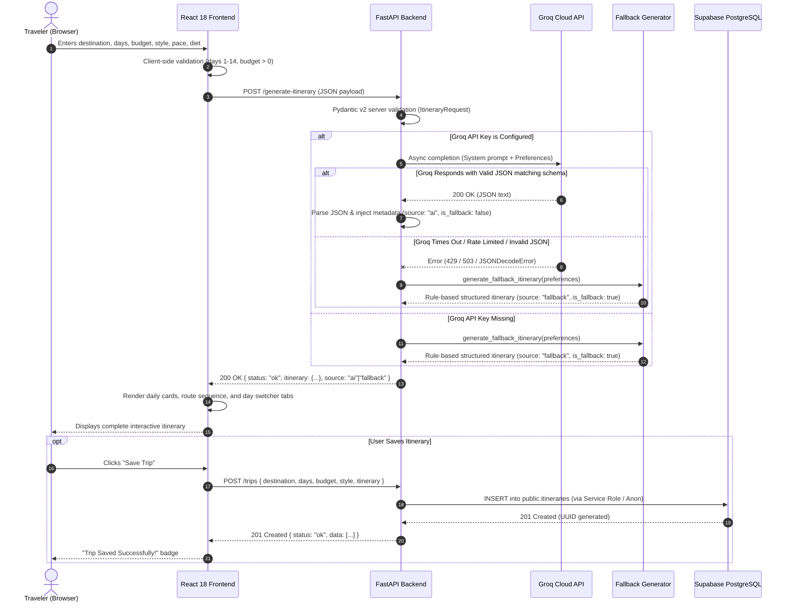
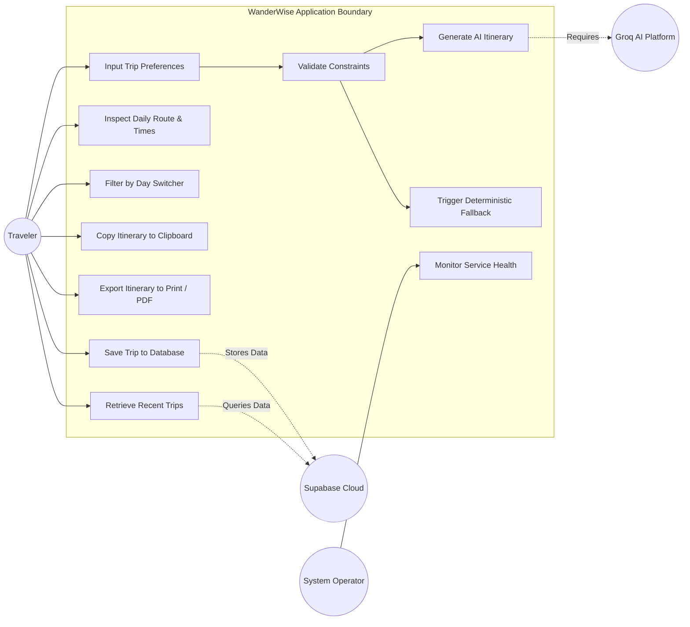
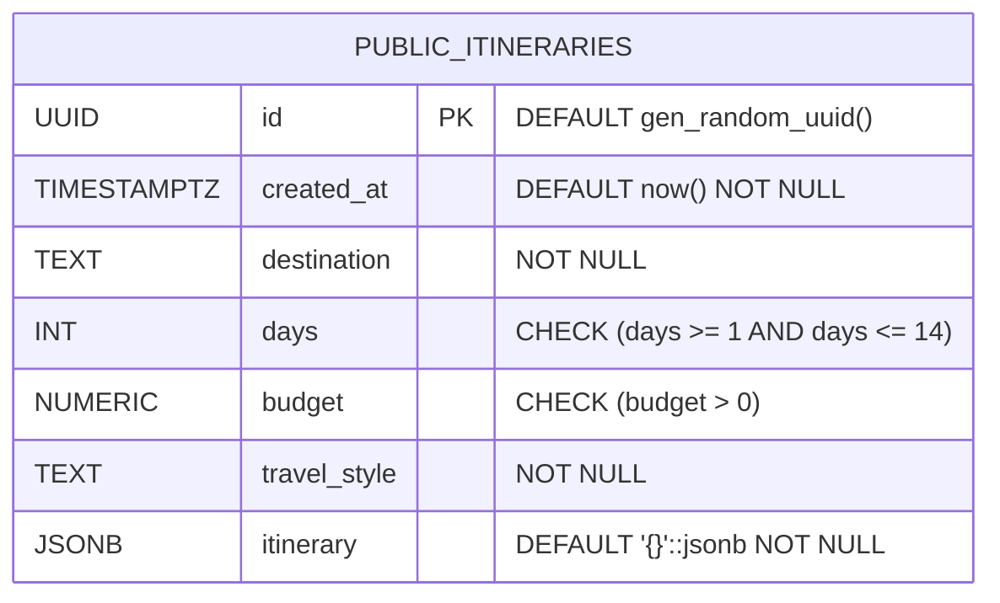

# WanderWise — Personalized Travel Itinerary Planner
## Phase 3: Project Design Phase Documentation

---

### Project Header & Administrative Information

| Parameter | Details |
| :--- | :--- |
| **Project Title** | WanderWise — Generative AI-Based Personalized Travel Itinerary Planner |
| **Project Category** | Generative Artificial Intelligence (Generative AI) |
| **Document Phase** | Phase 3: Project Design Phase |
| **Date** | 19 September 2026 |
| **Team ID** | [TO BE PROVIDED] |
| **Repository URL** | [https://github.com/Aanchal1121/personalized-travel-itinerary-planner](https://github.com/Aanchal1121/personalized-travel-itinerary-planner) |
| **Maximum Marks** | 9 Marks (Solution Architecture: 4, Project Proposal: 3, Problem-Solution Fit: 2) |

---

## 1. Project Proposal (Proposed Solution) (Maximum Marks: 3 Marks)

### 1.1 Project Overview
* **Objective**: To architect, develop, and deploy an autonomous, web-based Generative AI travel itinerary planner that ingests traveler preferences (destination, duration, budget, style, interests, pace, group size, and dietary restrictions) and outputs structured, topologically sequenced, day-by-day itineraries with morning, afternoon, and evening activities, duration timings, estimated transit buffers, and budget strategies in under 3 seconds.
* **Scope**:
  * In-Scope: Multi-step interactive preference intake, client/server input validation, Groq cloud LLM inference (`openai/gpt-oss-20b` or `llama-3.3-70b-versatile`), prompt engineering enforcing strict JSON schema compliance, deterministic rule-based local fallback generation, Supabase PostgreSQL persistence with Row Level Security (RLS), clipboard copying, and print/PDF export.
  * Out-of-Scope: Live flight/hotel booking payment gateways, turn-by-turn vehicle GPS telematics, and real-time live traffic video streaming.

### 1.2 Problem Statement
* **Description**: Traditional travel planning requires tourists to consult dozens of fragmented blogs, reviews, and maps, manually calculating travel times and clustering landmarks. Existing commercial tools either deliver rigid, one-size-fits-all tour packages or produce unformatted, hallucinated chatbot responses that lack geographic logic, transit buffers, or dietary awareness.
* **Impact**: Eliminating planning friction saves 10 to 20 hours per trip, mitigates travel fatigue by sequencing attractions geographically to prevent citywide backtracking, and provides reliable schedule continuity via a built-in deterministic fallback engine.

### 1.3 Proposed Solution
* **Approach**: A modern decoupled 3-tier web architecture. A client-side Single Page Application (React 18 + Vite 5) collects and validates preferences, dispatching an asynchronous REST payload to a FastAPI backend. The backend constructs a structured prompt for Groq's high-speed LPU inference engine. If the LLM generates valid JSON matching the schema, it returns the AI itinerary; if the external service fails or is unconfigured, the backend automatically activates a local deterministic fallback generator. The resulting itinerary can be persisted directly to a Supabase PostgreSQL database using secure server-side credentials.
* **Key Features**:
  1. *Sub-3-second AI generation* via Groq LPUs.
  2. *Geographic route sequencing* (`Stop 1 ➔ Stop 2 ➔ Stop 3`) minimizing urban transit backtracking.
  3. *Zero-crash reliability* via deterministic rule-based local fallback.
  4. *Explainable vibe-based personalization* tailored to diet, budget, and pace.
  5. *Secure cloud persistence* backed by Supabase PostgreSQL and Row-Level Security.

### 1.4 Resource Requirements

| Resource Type | Category | Description & Specification |
| :--- | :--- | :--- |
| **Hardware** | **Development Client** | Standard developer PC or laptop: 4-core 64-bit CPU (Intel Core i5/AMD Ryzen 5 or equivalent), 8 GB RAM, 256 GB SSD storage. |
| **Hardware** | **Hosting Server** | Cloud virtual instances: Render Web Service (512 MB – 1 GB RAM, shared vCPU), Vercel/Netlify global edge CDN. |
| **Software** | **Backend Framework** | Python 3.10+, FastAPI 0.110+, Uvicorn 0.28+, Pydantic v2. |
| **Software** | **Frontend Stack** | Node.js 18+, React 18, Vite 5, Vanilla CSS design system, Google Fonts (*Plus Jakarta Sans*). |
| **Software** | **AI Inference Engine** | Groq Cloud API (`groq` Python SDK), model `openai/gpt-oss-20b` or `llama-3.3-70b-versatile`. |
| **Software** | **Database & Storage** | Supabase PostgreSQL 15+ with PostgREST REST interface, SQL RLS policies, JSONB support. |
| **Software** | **Dev Tools & VCS** | Git, GitHub, VS Code, PowerShell / Bash terminal. |
| **Data** | **Payload Specifications**| JSON structured request schemas (`ItineraryRequest`, `TripCreate`), strictly validated JSON response schemas, and structured prompt definitions. |

---

## 2. Problem — Solution Fit (Maximum Marks: 2 Marks)

The Problem-Solution Fit framework verifies that WanderWise features directly address observed customer pain points and behaviors.

```
+---------------------------------------------------------------------------------------------------------+
|                                    PROBLEM - SOLUTION FIT CANVAS                                        |
+---------------------------------------------------------------------------------------------------------+
|  CUSTOMER SEGMENT & ANNOYANCES (Problem State)                                                          |
|  - Independent travelers spending 15+ hours researching blogs, spreadsheets, and maps.                  |
|  - Travelers experiencing travel burnout due to backtracking across opposite sides of a city.          |
|  - Dieters (vegetarians, vegans) finding standard travel itineraries insensitive to their meal needs.   |
|  - Users frustrated by AI tools that crash or spit out unstructured conversational walls of text.      |
+---------------------------------------------------------------------------------------------------------+
|  EXISTING BEHAVIOR & TRIGGERS (Channels)                                                                |
|  - Trigger: Deciding to take a vacation or city break within a specific budget and timeframe.           |
|  - Channels: Web search engines, mobile browsers, travel forums, social travel communities.             |
|  - Current Workaround: Juggling 20+ tabs between TripAdvisor, Google Maps, Yelp, and Notes app.         |
+---------------------------------------------------------------------------------------------------------+
|  WANDERWISE SOLUTION FEATURES (Product Capabilities)                                                    |
|  - Multi-Step Preference Engine: Captures destination, dates (1-14 days), budget, pace, and diet.        |
|  - Geographic Clustering Prompt: Directs the LLM to sequence activities geographically in route order.   |
|  - Time & Duration Synthesis: Allocates visit minutes and transit buffers for morning/afternoon/evening.|
|  - High-Quality Fallback Engine: Delivers an instant, schema-valid travel plan even if AI API is down. |
|  - Cloud Trip Saving & One-Click PDF: Exports clean, formatted itineraries for offline field access.    |
+---------------------------------------------------------------------------------------------------------+
|  MEASURABLE VALUE FIT & RESULTS (Customer Outcome)                                                      |
|  - 95% Reduction in Planning Time: Full customized itinerary synthesized in < 3 seconds.               |
|  - Zero Backtracking: Consecutive stops grouped by urban quadrant.                                      |
|  - 100% Operational Reliability: Local fallback guarantees zero blank screens or 500 error walls.        |
|  - Enhanced Travel Confidence: Clear budget allocations, dietary notes, and backup alternatives.        |
+---------------------------------------------------------------------------------------------------------+
```

---

## 3. Solution Architecture & System Models (Maximum Marks: 4 Marks)

### 3.1 High-Level System Architecture Diagram
The WanderWise architecture follows a clean 3-tier decoupled model with asynchronous orchestration:



### 3.2 Component Description Table

| Component Name | Description / Role in Architecture | Technology Used | File in Repository |
| :--- | :--- | :--- | :--- |
| **Frontend UI View** | Responsive, dark-themed SPA rendering the multi-step form wizard, day tabs, route flows, and export actions. | React 18, Vite 5, JSX, Vanilla CSS | [App.jsx](file:///e:/personalized-travel-itinerary-planner/frontend/src/App.jsx)<br>[App.css](file:///e:/personalized-travel-itinerary-planner/frontend/src/App.css) |
| **Client Validation Helper** | Schema validation, default preferences, and sanitization before network dispatch. | JavaScript (ESM) | [travelPrompt.js](file:///e:/personalized-travel-itinerary-planner/frontend/src/lib/travelPrompt.js) |
| **Supabase Client Helper** | Safe client-side Supabase client initialization using publishable anon key. | `@supabase/supabase-js` | [supabase.js](file:///e:/personalized-travel-itinerary-planner/frontend/src/lib/supabase.js) |
| **FastAPI Core Gateway** | Application entry point, CORS configuration, API routes (`/health`, `/generate-itinerary`, `/trips`), and error handling. | FastAPI, Python 3.10+, Uvicorn | [main.py](file:///e:/personalized-travel-itinerary-planner/backend/main.py) |
| **Pydantic Validation Models** | Enforces strict type boundaries, ranges (days 1–14, budget > 0), and JSON serialization. | Pydantic v2 (`BaseModel`, `Field`) | [main.py](file:///e:/personalized-travel-itinerary-planner/backend/main.py#L67-L86) |
| **Abstract LLM Base Class** | Formal interface (`BaseLLMProvider`) ensuring modularity and pluggability for alternative AI providers. | Python `abc` (Abstract Base Classes) | [base.py](file:///e:/personalized-travel-itinerary-planner/backend/llm/base.py) |
| **Groq Provider** | Asynchronous wrapper around Groq Cloud Python SDK performing completion calls against supported LLMs. | `groq` Python SDK, `asyncio` | [groq_provider.py](file:///e:/personalized-travel-itinerary-planner/backend/llm/groq_provider.py) |
| **Structured Prompt Builder** | System instructions and few-shot formatting rules forcing the LLM to output valid JSON with geographic sequencing. | Python string templates | [prompts.py](file:///e:/personalized-travel-itinerary-planner/backend/llm/prompts.py) |
| **Deterministic Fallback Engine** | Offline, rule-based itinerary synthesizer generating fully compliant multi-day travel schedules when AI fails. | Pure Python, structured domain dictionaries | [fallback_generator.py](file:///e:/personalized-travel-itinerary-planner/backend/fallback_generator.py) |
| **Supabase Database Schema** | Relational table storing saved trips, metadata, and complete nested itinerary JSONB objects with RLS. | Supabase PostgreSQL, SQL DDL, RLS policies | [supabase_rls_setup.sql](file:///e:/personalized-travel-itinerary-planner/supabase_rls_setup.sql) |

---

## 4. Interaction Diagrams

### 4.1 Sequence Diagram: Itinerary Generation & Fallback Workflow
This sequence diagram illustrates the complete execution flow, including decision branches for successful AI completion and graceful fallback handling:



### 4.2 Use Case Diagram
The Use Case diagram visualizes the primary interactions between the Traveler, the System Operator, and External Services:



---

## 5. Database Schema & Data Models

### 5.1 Relational Schema (`public.itineraries`)
The database design leverages PostgreSQL's binary JSON format (`JSONB`) to accommodate rich, hierarchical multi-day itineraries without needing cumbersome multi-table joins for morning/afternoon/evening sub-entities.



### 5.2 SQL Definition & Constraint Implementation
As documented in the repository's [supabase_rls_setup.sql](file:///e:/personalized-travel-itinerary-planner/supabase_rls_setup.sql):

```sql
-- Ensure public.itineraries table exists with appropriate constraints
CREATE TABLE IF NOT EXISTS public.itineraries (
    id UUID PRIMARY KEY DEFAULT gen_random_uuid(),
    created_at TIMESTAMPTZ DEFAULT now() NOT NULL,
    destination TEXT NOT NULL,
    days INT NOT NULL CHECK (days >= 1 AND days <= 14),
    budget NUMERIC NOT NULL CHECK (budget > 0),
    travel_style TEXT NOT NULL,
    itinerary JSONB NOT NULL DEFAULT '{}'::jsonb
);

-- Row Level Security (RLS) policies
ALTER TABLE public.itineraries ENABLE ROW LEVEL SECURITY;

GRANT USAGE ON SCHEMA public TO anon, authenticated, service_role;
GRANT ALL ON TABLE public.itineraries TO service_role;
GRANT SELECT, INSERT ON TABLE public.itineraries TO anon, authenticated;

CREATE POLICY "Allow public insert to itineraries"
ON public.itineraries FOR INSERT TO anon, authenticated
WITH CHECK (true);

CREATE POLICY "Allow public select from itineraries"
ON public.itineraries FOR SELECT TO anon, authenticated
USING (true);
```

---

## 6. API Design Specification

| Endpoint | HTTP Method | Request Payload | Response Status & Body | Description |
| :--- | :---: | :--- | :--- | :--- |
| `/health` | `GET` | *None* | `200 OK`<br>`{ status: "ok", app: "...", version: "1.0.0", groq_configured: bool, supabase_configured: bool }` | Verifies backend readiness and environment key presence. |
| `/health/supabase` | `GET` | *None* | `200 OK`<br>`{ status: "ok", database: "connected" }` | Validates database connectivity by running `SELECT id LIMIT 1`. |
| `/generate-itinerary` | `POST` | `ItineraryRequest` (JSON) | `200 OK`<br>`{ status: "ok", itinerary: {...}, source: "ai"|"fallback", is_fallback: bool }`<br>`422 Unprocessable Entity` on invalid fields. | Core endpoint executing AI prompt inference or fallback generation. |
| `/trips` | `POST` | `TripCreate` (JSON) | `201 Created`<br>`{ status: "ok", message: "Trip saved successfully.", data: [...] }`<br>`500 Internal Server Error` on RLS failure. | Persists generated itinerary record to Supabase table. |
| `/trips` | `GET` | Query param: `?limit=10` (default 10, max 50) | `200 OK`<br>`{ status: "ok", trips: [ { id, created_at, destination, days, budget, travel_style } ] }` | Retrieves list of recently saved trips. |

---

## 7. AI Prompt Architecture & Fallback Design

### 7.1 Structured Prompt Formulation (`backend/llm/prompts.py`)
To prevent LLM conversational chit-chat, hallucinations, and formatting errors, the prompt builder applies strict few-shot instructions:
1. **Explicit Role**: Defines the assistant as an expert local travel guide and route optimizer.
2. **Schema Enforcement**: Injects a strict JSON schema template into the system instruction, demanding output beginning with `{` and ending with `}`.
3. **Geographic Sequencing Directive**: Demands morning, afternoon, and evening attractions to be clustered in the same city quadrant, eliminating zig-zagging.
4. **Pacing & Duration Calibration**: Enforces visit durations in minutes ($90$–$180$ mins) and realistic transit buffers ($15$–$35$ mins).
5. **No Fictitious Pricing**: Instructs the LLM to give pragmatic daily budget guidance rather than inventing volatile ticket prices.

### 7.2 Deterministic Local Fallback Architecture (`backend/fallback_generator.py`)
The fallback generator is engineered as an offline rule engine:
* **Style Pools**: Curated activity banks for 4 core styles (`adventure`, `culture`, `food`, `relaxation`), each segmented into morning, afternoon, and evening blocks.
* **Pace Multipliers**: Applies dynamic duration multipliers (`relaxed`: $0.85\times$, `balanced`: $1.0\times$, `fast-paced`: $1.15\times$).
* **Transit Calculators**: Dynamically computes transit buffers based on pace base times.
* **Schema Parity**: The fallback dictionary matches 100% of the keys produced by the AI engine, ensuring the frontend renders seamlessly with zero code differentiation.

---

## 8. Phase 3 Sign-Off & Verification Checklist

| Architecture & Design Deliverable | Status | Verification Reference |
| :--- | :---: | :--- |
| Project Proposal (Objective, Scope, Impact, Resources) | Completed | Section 1 (Full proposal with hardware/software allocation) |
| Problem-Solution Fit Canvas | Completed | Section 2 (Mural/Ideahackers standard canvas format) |
| High-Level System Architecture Diagram | Completed | Section 3.1 (Decoupled 3-tier Mermaid diagram) |
| Architectural Component Table | Completed | Section 3.2 (All 10 repository modules cataloged) |
| End-to-End Sequence Diagram | Completed | Section 4.1 (Mermaid sequence diagram with fallback branch) |
| System Use Case Diagram | Completed | Section 4.2 (Actor-boundary Mermaid diagram) |
| Database ERD & DDL Schema | Completed | Section 5 (PostgreSQL ERD & verified RLS DDL script) |
| REST API Design Specification | Completed | Section 6 (HTTP methods, payloads, responses, status codes) |
| AI Prompt & Fallback Architecture | Completed | Section 7 (Structured schema enforcement & rule engine) |
