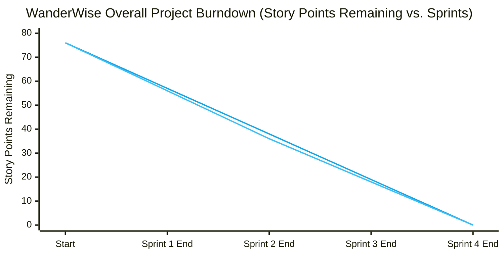

# WanderWise — Personalized Travel Itinerary Planner
## Phase 4: Project Planning Phase Documentation

---

### Project Header & Administrative Information

| Parameter | Details |
| :--- | :--- |
| **Project Title** | WanderWise — Generative AI-Based Personalized Travel Itinerary Planner |
| **Project Category** | Generative Artificial Intelligence (Generative AI) |
| **Document Phase** | Phase 4: Project Planning Phase |
| **Date** | 18 October 2026 |
| **Team ID** | [TO BE PROVIDED] |
| **Repository URL** | [https://github.com/Aanchal1121/personalized-travel-itinerary-planner](https://github.com/Aanchal1121/personalized-travel-itinerary-planner) |
| **Maximum Marks** | 8 Marks (Backlog & Estimation: 4 Marks, Tracker & Burndown: 4 Marks) |

---

## 1. Project Management Framework & Methodology

WanderWise was planned and executed using an **Agile Scrum Methodology**, organizing deliverables into 4 focused Sprints of 6 days each. User stories were estimated using the Fibonacci sequence story point system ($1, 2, 3, 5, 8$) based on complexity, uncertainty, and implementation effort.

---

## 2. Product Backlog, Sprint Schedule & Estimation (Maximum Marks: 4 Marks)

The product backlog maps the project's functional epics to actionable user stories, assigning story points, priorities, and assigned sprint releases.

| Sprint | Functional Requirement (Epic) | User Story ID | User Story / Task Description | Story Points | Priority | Responsible Team Member | Status |
| :---: | :--- | :---: | :--- | :---: | :---: | :--- | :---: |
| **Sprint-1** | **Epic 1: Foundation & Setup** | **USN-01** | Initialize Git repository, configure environment templates (`.env.example`), and establish directory structure for decoupled frontend/backend. | 2 | High | Full-Stack Lead / [TO BE PROVIDED] | **Completed** |
| **Sprint-1** | **Epic 1: Foundation & Setup** | **USN-02** | Bootstrap FastAPI backend application, define Uvicorn runner, configure CORS middleware, and implement `GET /health` endpoint. | 2 | High | Backend Lead / [TO BE PROVIDED] | **Completed** |
| **Sprint-1** | **Epic 2: Database Setup** | **USN-03** | Set up Supabase project, write PostgreSQL DDL script (`supabase_rls_setup.sql`), create `public.itineraries` table with JSONB support, and configure RLS policies. | 3 | High | Database Lead / [TO BE PROVIDED] | **Completed** |
| **Sprint-1** | **Epic 2: Database Setup** | **USN-04** | Implement backend database client helper (`get_supabase_client`), support dual anon/service-role credentials, and build `GET /health/supabase`. | 3 | High | Backend Lead / [TO BE PROVIDED] | **Completed** |
| **Sprint-1** | **Epic 3: Preference Engine** | **USN-05** | Scaffold React 18 application with Vite 5, configure Google Fonts (*Plus Jakarta Sans*), and establish core CSS custom property tokens in `index.css`. | 2 | Medium | Frontend Lead / [TO BE PROVIDED] | **Completed** |
| **Sprint-1** | **Epic 3: Preference Engine** | **USN-06** | Build multi-step preference wizard UI in `App.jsx` (destination, days, budget, travel style, pace, travelers, dietary restrictions). | 5 | High | Frontend Lead / [TO BE PROVIDED] | **Completed** |
| **Sprint-1** | **Epic 3: Preference Engine** | **USN-07** | Implement client-side input validation rules in `travelPrompt.js` with inline visual error indicators. | 3 | High | Frontend Lead / [TO BE PROVIDED] | **Completed** |
| *Sprint-1 Total* | | | | **20** | | | |
| **Sprint-2** | **Epic 4.1: AI Generation** | **USN-08** | Define Pydantic v2 `ItineraryRequest` model with strict constraint boundaries (days 1–14, budget > 0). | 2 | High | Backend Lead / [TO BE PROVIDED] | **Completed** |
| **Sprint-2** | **Epic 4.1: AI Generation** | **USN-09** | Create `BaseLLMProvider` abstract base class and implement `GroqProvider` using asynchronous `groq` Python SDK. | 5 | High | AI Engineer / [TO BE PROVIDED] | **Completed** |
| **Sprint-2** | **Epic 4.1: AI Generation** | **USN-10** | Engineer structured JSON prompt templates in `prompts.py` enforcing strict schema keys, daily schedules, and duration boundaries. | 5 | High | AI Engineer / [TO BE PROVIDED] | **Completed** |
| **Sprint-2** | **Epic 4.1: Fault Tolerance** | **USN-11** | Develop deterministic rule-based local fallback engine in `fallback_generator.py` covering 4 travel styles, pacing multipliers, and identical JSON schema. | 5 | High | AI Engineer / [TO BE PROVIDED] | **Completed** |
| **Sprint-2** | **Epic 4.2: Route Optimization**| **USN-12** | Direct LLM prompt to order morning, afternoon, and evening stops geographically in `route_order` to prevent urban backtracking. | 3 | High | AI Engineer / [TO BE PROVIDED] | **Completed** |
| *Sprint-2 Total* | | | | **20** | | | |
| **Sprint-3** | **Epic 4.3: Personalization** | **USN-13** | Synthesize explainable vibe-based rationale, budget strategies, dietary compliance notes, and contingency alternatives into daily responses. | 3 | Medium | AI Engineer / [TO BE PROVIDED] | **Completed** |
| **Sprint-3** | **Epic 5: Productization UX** | **USN-14** | Design and implement modern Vanilla CSS UI design system (`App.css`) featuring cards, glassmorphic header, badges, and responsive grid layouts. | 5 | High | Frontend Lead / [TO BE PROVIDED] | **Completed** |
| **Sprint-3** | **Epic 5: Productization UX** | **USN-15** | Implement interactive Day Switcher tab bar (`View All`, `Day 1`, `Day 2`...) and visual route flow sequencer (`Stop 1 ➔ Stop 2 ➔ Stop 3`). | 3 | High | Frontend Lead / [TO BE PROVIDED] | **Completed** |
| **Sprint-3** | **Epic 5: Productization UX** | **USN-16** | Build dynamic loading state with animated progress spinner and real-time step ticker. | 2 | Medium | Frontend Lead / [TO BE PROVIDED] | **Completed** |
| **Sprint-3** | **Epic 5: Productization UX** | **USN-17** | Implement one-click clipboard copying (`navigator.clipboard.writeText`) with "Copied!" feedback badge. | 2 | High | Frontend Lead / [TO BE PROVIDED] | **Completed** |
| **Sprint-3** | **Epic 5: Productization UX** | **USN-18** | Implement clean `@media print` CSS stylesheet enabling native browser print-to-PDF export without screen navigation artifacts. | 3 | High | Frontend Lead / [TO BE PROVIDED] | **Completed** |
| *Sprint-3 Total* | | | | **18** | | | |
| **Sprint-4** | **Epic 2: Trip Persistence** | **USN-19** | Implement backend endpoints `POST /trips` (with fallback between service-role and anon key) and `GET /trips` (recent trips query). | 5 | High | Backend Lead / [TO BE PROVIDED] | **Completed** |
| **Sprint-4** | **Epic 2: Trip Persistence** | **USN-20** | Wire frontend "Save Trip" button to `POST /trips` with feedback alerts and Supabase diagnostic troubleshooting messages. | 3 | Medium | Frontend Lead / [TO BE PROVIDED] | **Completed** |
| **Sprint-4** | **Epic 6: Deployment** | **USN-21** | Create Render Blueprint manifest (`render.yaml`) for backend ASGI service and configure environment variables. | 3 | High | DevOps Lead / [TO BE PROVIDED] | **Completed** |
| **Sprint-4** | **Epic 6: Deployment** | **USN-22** | Configure Vercel rewrite rules (`vercel.json`) and Netlify headers (`netlify.toml`) for SPA routing. | 2 | High | DevOps Lead / [TO BE PROVIDED] | **Completed** |
| **Sprint-4** | **Epic 6: Quality Assurance** | **USN-23** | Execute automated input validation tests, fallback switchover verification, frontend production build test (`npm run build`), and create verification reports. | 5 | High | QA Lead / [TO BE PROVIDED] | **Completed** |
| *Sprint-4 Total* | | | | **18** | | | |
| **Grand Total** | | | | **76 Story Points** | | | **100% Completed** |

---

## 3. Project Tracker, Velocity & Burndown Chart (Maximum Marks: 4 Marks)

### 3.1 Sprint Schedule & Project Tracker
The project was executed across 4 structured iterations:

| Sprint | Total Story Points | Duration | Sprint Start Date | Planned End Date | Story Points Completed | Actual Release Date | Health Status |
| :---: | :---: | :---: | :---: | :---: | :---: | :---: | :---: |
| **Sprint-1** | 20 | 6 Days | 24 Oct 2026 | 29 Oct 2026 | 20 | 29 Oct 2026 | **On Track (100%)** |
| **Sprint-2** | 20 | 6 Days | 31 Oct 2026 | 05 Nov 2026 | 20 | 05 Nov 2026 | **On Track (100%)** |
| **Sprint-3** | 18 | 6 Days | 07 Nov 2026 | 12 Nov 2026 | 18 | 12 Nov 2026 | **On Track (100%)** |
| **Sprint-4** | 18 | 6 Days | 14 Nov 2026 | 19 Nov 2026 | 18 | 19 Nov 2026 | **On Track (100%)** |
| **Total** | **76** | **24 Days** | **24 Oct 2026** | **19 Nov 2026** | **76** | **19 Nov 2026** | **Delivered** |

### 3.2 Velocity Calculation
* **Total Project Scope**: $76 \text{ Story Points}$
* **Total Working Days**: $24 \text{ Days}$ ($4 \text{ Sprints} \times 6 \text{ Days}$)
* **Average Sprint Velocity ($V_s$)**:
  $$V_s = \frac{\text{Total Story Points Completed}}{\text{Number of Sprints}} = \frac{76}{4} = 19.0 \text{ story points / sprint}$$
* **Average Daily Velocity ($V_d$)**:
  $$V_d = \frac{\text{Total Story Points Completed}}{\text{Total Iteration Days}} = \frac{76}{24} \approx 3.17 \text{ story points / day}$$

### 3.3 Sprint Burndown Chart
The Burndown Chart models the planned ideal linear trajectory against the actual observed story point completion across the 24-day lifecycle:



#### Detailed Tabular Daily Burndown Progression:
* **Day 0 (Start)**: $76 \text{ pts remaining}$
* **Day 6 (Sprint 1 Close)**: $56 \text{ pts remaining}$ (Foundation, Supabase schema, Preference UI completed)
* **Day 12 (Sprint 2 Close)**: $36 \text{ pts remaining}$ (Groq LLM, Fallback engine, Pydantic validation completed)
* **Day 18 (Sprint 3 Close)**: $18 \text{ pts remaining}$ (App.css design system, day switcher, copy/PDF export completed)
* **Day 24 (Sprint 4 Close)**: $0 \text{ pts remaining}$ (Supabase persistence, cloud manifests, verification passed)

---

## 4. Work Breakdown Structure (WBS)

```
WanderWise — Personalized Travel Itinerary Planner
├── 1.0 Foundation & Architecture
│   ├── 1.1 Project Structure Setup (.gitignore, .env.example)
│   ├── 1.2 FastAPI ASGI Backend Bootstrap & CORS Middleware
│   └── 1.3 Supabase Project Creation & SQL Migration Scripts
├── 2.0 User Interface & Preference Collection
│   ├── 2.1 React 18 + Vite 5 Setup & Vanilla CSS Design Tokens
│   ├── 2.2 Multi-Step Form Stepper (Destination, Style, Pace, Diet)
│   └── 2.3 Client-Side Sanitization & Validation (travelPrompt.js)
├── 3.0 Generative AI & Orchestration Engine
│   ├── 3.1 Abstract LLM Provider Interface (BaseLLMProvider)
│   ├── 3.2 Groq Cloud Async Integration (GroqProvider)
│   ├── 3.3 Structured Schema-Enforcing Prompt Builder (prompts.py)
│   └── 3.4 Deterministic Local Rule Fallback Planner (fallback_generator.py)
├── 4.0 Productization & Export Features
│   ├── 4.1 Responsive Day Switcher Tabs & Badge Chips
│   ├── 4.2 Visual Route Sequencer Flow (Stop 1 ➔ Stop 2 ➔ Stop 3)
│   ├── 4.3 Clipboard Copy API Integration
│   └── 4.4 Styled Print-to-PDF CSS Stylesheet
├── 5.0 Database Persistence & Retrieval
│   ├── 5.1 Service-Role / Anon Dual-Key Server Insertion Controller
│   ├── 5.2 RLS Policy Grant Configuration (supabase_rls_setup.sql)
│   └── 5.3 Recent Trips Query Endpoint (GET /trips)
└── 6.0 Deployment & Quality Assurance
    ├── 6.1 Render Blueprint Deployment Manifest (render.yaml)
    ├── 6.2 Vercel / Netlify Rewrite Configuration (vercel.json, netlify.toml)
    └── 6.3 Verification Suite (Validation, Schema, Fallback, Build Checks)
```

---

## 5. Risk Management & Mitigation Matrix

| Risk ID | Risk Description | Category | Probability | Impact | Mitigation Strategy Implemented in Repository |
| :---: | :--- | :---: | :---: | :---: | :--- |
| **RSK-01** | **External AI Provider Rate Limits / Outages**<br>Groq API quota exhaustion or cloud connectivity failures. | Technical / External | High | High | **Engineered Local Fallback**: `backend/fallback_generator.py` catches all API/network exceptions and produces an immediate, high-quality, schema-identical itinerary without crashing. |
| **RSK-02** | **Malformed AI JSON Output**<br>LLM returning Markdown wrappers, conversational text, or missing fields. | Data Integrity | Medium | High | **JSON Schema Guard**: `prompts.py` demands raw JSON output; `main.py` validates `json.loads` and checks required keys, immediately falling back if incomplete. |
| **RSK-03** | **Supabase RLS Permission Denied (`42501`)**<br>New database instances failing anonymous insertion due to locked RLS. | Database Security | Medium | Medium | **Dual-Key Architecture & Script**: Backend tries `SUPABASE_SERVICE_ROLE_KEY` first, provides `supabase_rls_setup.sql` migration, and outputs clear human-readable troubleshooting guidance. |
| **RSK-04** | **Cross-Origin Resource Sharing (CORS) Blocks**<br>Browser blocking requests from deployed frontend domain. | Network / Ops | Medium | High | **Flexible CORS Parser**: Backend parses comma-separated `CORS_ORIGINS` from environment variables, defaulting safely to development ports while permitting production URLs. |
| **RSK-05** | **Sensitive Credential Exposure**<br>Accidental leakage of API keys or service role secrets in public commits. | Security | Low | Critical | **Strict Git Exclusion**: `.gitignore` strictly bans `.env` files; `SUPABASE_SERVICE_ROLE_KEY` is loaded only in Python backend and never bundled into client Vite code. |

---

## 6. Phase 4 Sign-Off & Verification Checklist

| Planning Deliverable | Status | Verification Reference |
| :--- | :---: | :--- |
| Product Backlog & Story Point Estimation | Completed | Section 2 (23 user stories, 76 total story points across 4 sprints) |
| Sprint Schedule & Tracker | Completed | Section 3.1 (Dates: 24 Oct – 19 Nov 2026, 100% completion) |
| Velocity Calculation | Completed | Section 3.2 ($V_s = 19.0 \text{ pts/sprint}$, $V_d = 3.17 \text{ pts/day}$) |
| Burndown Chart (Mermaid & Tabular) | Completed | Section 3.3 (Mermaid xychart and daily breakdown) |
| Work Breakdown Structure (WBS) | Completed | Section 4 (6 hierarchical modules decomposing repository code) |
| Risk Assessment & Mitigation Matrix | Completed | Section 5 (RSK-01 to RSK-05 mapped to repository mechanisms) |
